  

[LinkedIn ›](https://www.linkedin.com/in/yohan-kevin-bayonacoronel-083761261) &nbsp;&nbsp;&nbsp;&nbsp; [Email ›](mailto:ybayona@jdc.edu.co) &nbsp;&nbsp;&nbsp;&nbsp; [WhatsApp ›](https://wa.me/573165791767)

 

  

### Las herramientas.

 

  

  

### Constancia.

  

### ¿Tienes algo por construir?

[Hablemos ›](mailto:ybayona@jdc.edu.co)

 

Fundación Universitaria Juan de Castellanos &nbsp;·&nbsp; Tunja, Boyacá

